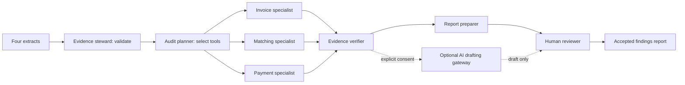

# AICA Purchase-to-Payment Audit Lab

A standalone Day 3 group-project prototype inspired by KU Internal Audit's source verification, visible tool activity and human review. The navy `#012060` and magenta `#92278f` were sampled from the saved AICA course slides; purple `#7030a0` and lavender provide supporting accents. The custom AICA Audit Lab mark is a project illustration, not an official ICAI logo.

## Run locally

Node.js 22.8 or later. No npm packages or API key are needed for the core app.

```powershell
cd C:\Users\ku1422\Documents\Github\KUAuditAssistantV2\AICA\p2p-audit
npm test
npm run serve
```

Open http://127.0.0.1:8773. The server exposes only `site/`. For a different local port, set `$env:PORT` before running it. Reload clears working records, reviews and gateway settings. The workspace starts empty. Download the separate sample CSV files from Evidence room, upload each to its matching extract, then run the audit. Inspect evidence under Exceptions, record a named decision, then export under Review & report. The Demo guide contains a six-minute, four-presenter walkthrough.

The supplied demonstration has 30 invoice records, 29 purchase orders, 28 receipts and 29 payments. Expected results: five exceptions, six distinct affected invoice records, AED 48,000 invoice population and AED 8,850 distinct affected invoice value. This value is associated with exceptions, not a confirmed loss.

## Import contract

Replace the four extracts in Evidence room using CSV or JSON arrays. Download CSV templates in the app. IDs must be unique within their own dataset. Duplicate invoice numbers are permitted so the audit can identify them. CSV provenance refers to physical file lines; JSON provenance is a record ordinal displayed with a header offset. Extra fields are ignored rather than retained.

| Extract | Required fields |
| --- | --- |
| Invoices | `invoice_id, invoice_number, vendor_id, po_id, date, amount, currency` |
| Purchase orders | `po_id, vendor_id, date, amount, currency` |
| Goods receipts | `receipt_id, po_id, date, accepted` |
| Payments | `payment_id, invoice_id, vendor_id, date, amount, currency` |

Dates: valid `YYYY-MM-DD`. Amounts: non-negative decimal, up to two decimals, no separators. Currency: uppercase three-letter code, one currency per audit. `accepted`: true or false. Limit: 2 MB and 5,000 records per extract. At least one invoice is required; explicitly empty companion extracts are supported. Money uses integer cents and rejects unsafe population totals.

Seven controls cover duplicate invoice numbers by supplier, aggregate invoice value above PO value, paid invoices without accepted PO-level receipt evidence, aggregate invoice overpayment, linked supplier mismatches, missing PO references and payment references to absent invoices. Tolerance affects PO overrun and overpayment. Negative credits and FX conversion are outside this prototype; reconcile credits and reversals separately.

## Agent framework

This is an explicit local tool-agent orchestration layer, not an autonomous LLM agent demonstration. Each specialist executes an actual deterministic tool. The planner skips specialists whose controls are disabled. A normal full run executes seven tools with a 30-second budget; model calls are zero. Stop discards partial results. The roles, tools, execution trace and selected controls are visible in Agent framework.



The browser executes specialists sequentially to make the trace bounded and reproducible. No agent can modify ERP records, expand extraction scope, browse externally or approve its own findings. Evidence verification confirms that references exist in the supplied population, not that source records are authentic or every narrative statement is correct. Provisional risk ratings are fixed by control and require professional assessment.

Changing an extract, control scope, tolerance or rerunning clears old results and reviews. Editing a reviewed narrative clears its current decision. Optional AI output also clears the current decision and cannot alter the condition, control, amount or evidence. Review history remains in the local workpaper. Human decisions require a reviewer name and basis. Accepted-findings HTML excludes pending, dismissed and further-evidence items. All-decisions CSV and draft HTML remain available. HTML text is escaped; CSV formula-like cells are neutralized.

## Compass model drafting

Run `npm run gateway` to start `gateway/compass-draft.mjs` on port 8780. The original workspace launcher starts both drafting and chat automatically. Drafting uses Core42 Compass chat completions and the same server-only `KUST_PROD_KUIAA` and `COMPASS_MODELS` settings as chat. It never falls back to another provider. The old OpenAI server entry point remains available only for explicit legacy use.

For the local demo, Configure AI drafting fills `http://127.0.0.1:8780/draft`. Leave the gateway token blank and save for this session unless your local server explicitly configures a token. Local mode binds to loopback and restricts allowed browser origins. Provider API keys belong in server environment settings, never in the browser token field. Hosted mode requires a strong gateway token and exact HTTPS origins; use the Compass hosting configuration for a separate draft service, starting `node gateway/compass-draft.mjs` with the host's PORT.

Each request previews its exact finding payload and requires explicit in-app confirmation. It sends the control, current narrative, follow-up questions and anonymous evidence aliases. Check edited narratives for sensitive details. The server and browser validate the draft fields, preserve evidence aliases and reject new numeric claims. Drafting changes only impact, recommendation and questions, clears the current review decision and never changes control results or amounts. A named human review remains required. Requests are bounded and rate limited. Health: `http://127.0.0.1:8780/health`.

## Compass RAG chatbot

The **Ask Compass** panel retrieves tool-guide passages and, after explicit opt-in, excerpts from the current audit run. It uses BM25 keyword retrieval with audit vocabulary aliases. The separate Compass gateway retrieves the guide from its own corpus and uses Core42 chat completions to produce source-cited, read-only explanations. It checks citation references and numeric tokens; professional review is still required for semantic accuracy. Questions and manually edited narratives must be checked for sensitive details before sending.

From this original workspace, run `npm run compass` to load the existing KU `.env` Compass settings into server memory. No credential is copied into the browser or published source. The local chatbot connects to `http://127.0.0.1:8781/chat`. For a public Pages chatbot, host the separate gateway using [the hosting instructions](deployment/compass-hosting.md), then enter its HTTPS URL and gateway access token under Connection. The token stays in tab memory. Conversations are cleared when the run or review context changes, and pending stale replies are discarded. Compass chat does not modify evidence, results or review decisions.

The public chat gateway URL is initially blank in `site/chat-config.json`. The frontend alone cannot run model calls or access a local `.env`; provider credentials and the gateway must be deployed separately. Docker deployment is provided. The gateway permits no automatic provider retries or fallback and has request, context and concurrency limits.

Live synthetic Compass checks verified both a tool-guide explanation and a current-run summary using the configured model. Narrative drafting and chatbot generation both use separately started Compass gateways.

## GitHub Pages deployment, when ready

```powershell
npm test
npm run build
```

`dist/` contains only the static application and synthetic demo. Relative asset/module URLs support a repository subpath. `.nojekyll` is included. No originals, course deck, gateway server, credentials, imported evidence or test fixtures are copied. Imported evidence lives in browser memory, and downloaded workpapers must be kept outside public publication paths.

A manual deployment workflow template is supplied at `deployment/github-pages.yml`. It has **not** been installed in the repository workflows or deployed. To activate later, copy it to `.github/workflows/aica-pages.yml`, select GitHub Actions as the Pages source, and run its manual workflow. The template assumes this repository layout (`AICA/p2p-audit`); update the two working-directory paths and artifact path if moving the tool to a separate repository. Publishing would replace this repository's Pages site, so use a dedicated repository if it already hosts something else. Ensure the repository and publication permissions are appropriate before making the source public.

The workflow tests and builds the app, uploads only `AICA/p2p-audit/dist`, and deploys that artifact. GitHub Pages hosts the static frontend; the optional gateway needs separate hosting. See [GitHub Pages custom workflows](https://docs.github.com/en/pages/getting-started-with-github-pages/using-custom-workflows-with-github-pages).

## Practical limits

PO-level receipt presence does not verify quantities, line-item matching, dates relative to payment or service quality. Duplicate detection normalizes supplier invoice numbers, and can generate legitimate repeats. Extraction coverage must be assessed by the reviewer. No approval workflow, bank details, sanctions, tax or fraud conclusion is inferred. Reviewer names are entered by the user and are not authenticated identities. Reload clears the workspace; the downloaded JSON is an evidence export, not a re-importable application session. Use synthetic data for the public group demo.

### Empty workspace and sample files

No sample population loads automatically. Record counts and invoice values appear only after upload; findings appear only after Run audit. Reload and Clear workspace remove the working population. Separate synthetic CSVs are available under `site/samples/` and through Sample CSV links in Evidence room. In the original workspace, copies are also in `AICA/sample-data/`. Upload all four files to reproduce the complete demo.
