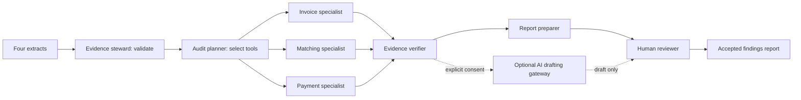

# AICA Purchase-to-Payment Audit Lab

A standalone Day 3 group-project prototype inspired by KU Internal Audit's source verification, visible tool activity and human review. The navy `#012060` and magenta `#92278f` were sampled from the saved AICA course slides; purple `#7030a0` and lavender provide supporting accents. The custom AICA Audit Lab mark is a project illustration, not an official ICAI logo.

## Run locally

Node.js 22.8 or later. No npm packages or API key are needed for the core app.

```powershell
cd AICA/p2p-audit
npm test
npm run serve
```

Open http://127.0.0.1:8773. The server exposes only `site/`. For a different local port, set `$env:PORT` before running it. Reload clears working records, reviews and gateway settings. Run the audit, inspect evidence under Exceptions, record a named decision, then export under Review & report. The Demo guide contains a six-minute, four-presenter walkthrough.

The supplied demonstration has 30 invoice records, 29 purchase orders, 28 receipts and 29 payments. Expected results: five exceptions, six distinct affected invoice records, AED 48,000 invoice population and AED 8,850 distinct affected invoice value. This value is associated with exceptions, not a confirmed loss.

## Import contract

Replace the four extracts in Evidence room using CSV or JSON arrays. Download CSV templates in the app. IDs must be unique within their own dataset. Duplicate invoice numbers are permitted so the audit can identify them. CSV provenance refers to physical file lines; JSON provenance is a record ordinal displayed with a header offset. Extra fields are ignored rather than retained.

| Extract | Required fields |
| --- | --- |
| Invoices | `invoice_id, invoice_number, vendor_id, po_id, date, amount, currency` |
| Purchase orders | `po_id, vendor_id, date, amount, currency` |
| Goods receipts | `receipt_id, po_id, date, accepted` |
| Payments | `payment_id, invoice_id, vendor_id, date, amount, currency` |

Dates: valid `YYYY-MM-DD`. Amounts: non-negative decimal, up to two decimals, no separators. Currency: uppercase three-letter code, one currency per audit. `accepted`: true or false. Limit: 2 MB and 5,000 records per extract. At least one invoice is required; explicitly empty companion extracts are supported. Money uses integer cents and rejects unsafe population totals.

Seven controls cover duplicate invoice numbers by supplier, aggregate invoice value above PO value, paid invoices without accepted PO-level receipt evidence, aggregate invoice overpayment, linked supplier mismatches, missing PO references and payment references to absent invoices. Tolerance affects PO overrun and overpayment. Negative credits and FX conversion are outside this prototype; reconcile credits and reversals separately.

## Agent framework

This is an explicit local tool-agent orchestration layer, not an autonomous LLM agent demonstration. Each specialist executes an actual deterministic tool. The planner skips specialists whose controls are disabled. A normal full run executes seven tools with a 30-second budget; model calls are zero. Stop discards partial results. The roles, tools, execution trace and selected controls are visible in Agent framework.



The browser executes specialists sequentially to make the trace bounded and reproducible. No agent can modify ERP records, expand extraction scope, browse externally or approve its own findings. Evidence verification confirms that references exist in the supplied population, not that source records are authentic or every narrative statement is correct. Provisional risk ratings are fixed by control and require professional assessment.

Changing an extract, control scope, tolerance or rerunning clears old results and reviews. Editing a reviewed narrative clears its current decision. Optional AI output also clears the current decision and cannot alter the condition, control, amount or evidence. Review history remains in the local workpaper. Human decisions require a reviewer name and basis. Accepted-findings HTML excludes pending, dismissed and further-evidence items. All-decisions CSV and draft HTML remain available. HTML text is escaped; CSV formula-like cells are neutralized.

## Optional model drafting

The core app works without this component. `gateway/server.mjs` is a separate Node server template using the Responses API with strict structured output. Provider requests use `store: false`; that is not a guarantee of zero retention under every provider/account policy. Consult your organization's approved data handling before use.

Set these environment variables on the gateway host using its secret management; do not commit them or place them in frontend files:

- `OPENAI_API_KEY`: provider credential, server only.
- `OPENAI_MODEL`: model available to your account that supports structured outputs.
- `GATEWAY_TOKEN`: a strong, session-scoped gateway credential.
- `ALLOWED_ORIGIN`: exact frontend origin, e.g. `http://127.0.0.1:8773` or `https://your-org.github.io` (no path/trailing slash).
- `GATEWAY_PORT`: optional, defaults to 8780.

Run `npm run gateway`. For local testing, enter `http://127.0.0.1:8780/draft` and the gateway token in Configure AI drafting. For deployed use, host this gateway separately behind HTTPS and organizational authentication. The supplied shared-token template is for a limited demo, not a full enterprise access-control solution. It binds to localhost and expects a secured reverse proxy when used remotely. CORS origin checks do not replace user authorization.

Each finding request requires explicit in-app confirmation and exposes its exact payload. It sends the control identifier, current narrative, questions and evidence aliases. Raw extracts, source IDs and amounts are excluded by construction from the initial rule templates, but manually edited narratives can contain sensitive facts: inspect them before sending. No automatic model request occurs. Client and server validate the response schema, evidence aliases and absence of new numeric claims; human review is still needed for semantic accuracy. The gateway restricts origins, uses bearer authentication, caps concurrent requests and applies per-address request limits. No request content or provider credential is logged.

Live model calls were not used for validation. Gateway tests use a mocked provider response to verify the request contract, origin/authentication handling and response gate.

References: [OpenAI structured outputs](https://developers.openai.com/api/docs/guides/structured-outputs?api-mode=responses), [Responses migration and storage](https://developers.openai.com/api/docs/guides/migrate-to-responses).

## GitHub Pages deployment, when ready

```powershell
npm test
npm run build
```

`dist/` contains only the static application and synthetic demo. Relative asset/module URLs support a repository subpath. `.nojekyll` is included. No originals, course deck, gateway server, credentials, imported evidence or test fixtures are copied. Imported evidence lives in browser memory, and downloaded workpapers must be kept outside public publication paths.

A manual deployment workflow template is supplied at `deployment/github-pages.yml`. The repository also has an active copy at `.github/workflows/aica-pages.yml` that deploys on pushes to main. To activate later, copy it to `.github/workflows/aica-pages.yml`, select GitHub Actions as the Pages source, and run its manual workflow. The template assumes this repository layout (`AICA/p2p-audit`); update the two working-directory paths and artifact path if moving the tool to a separate repository. Publishing would replace this repository's Pages site, so use a dedicated repository if it already hosts something else. Ensure the repository and publication permissions are appropriate before making the source public.

The workflow tests and builds the app, uploads only `AICA/p2p-audit/dist`, and deploys that artifact. GitHub Pages hosts the static frontend; the optional gateway needs separate hosting. See [GitHub Pages custom workflows](https://docs.github.com/en/pages/getting-started-with-github-pages/using-custom-workflows-with-github-pages).

## Practical limits

PO-level receipt presence does not verify quantities, line-item matching, dates relative to payment or service quality. Duplicate detection normalizes supplier invoice numbers, and can generate legitimate repeats. Extraction coverage must be assessed by the reviewer. No approval workflow, bank details, sanctions, tax or fraud conclusion is inferred. Reviewer names are entered by the user and are not authenticated identities. Reload clears the workspace; the downloaded JSON is an evidence export, not a re-importable application session. Use synthetic data for the public group demo.
